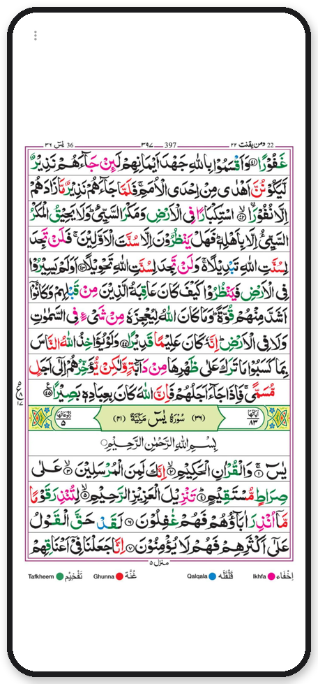
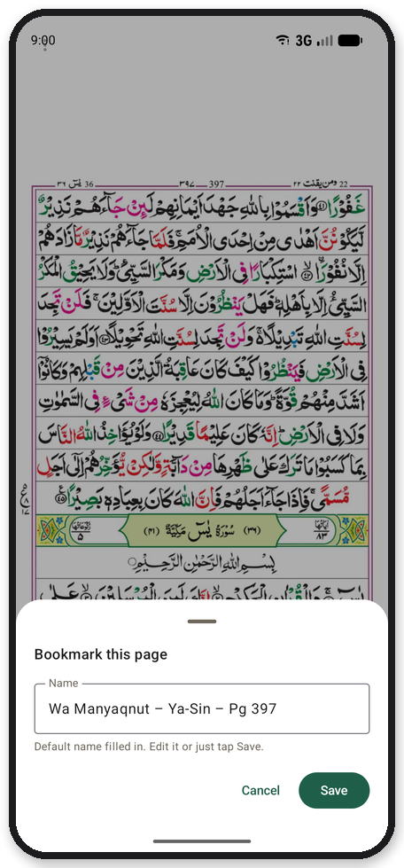
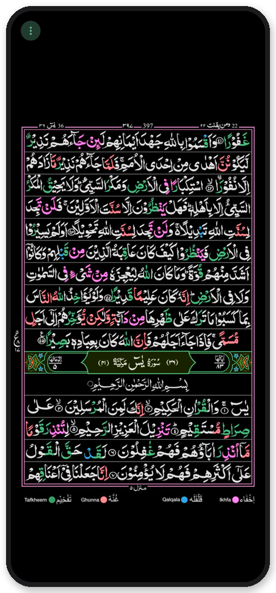

# Quran 16 Line: Free Offline Tajweed Quran App for Android (No Ads)

**Quran 16 Line** is a free, ad-free, offline Android app for reading the **16-line IndoPak Quran** (also called the *Hafizi Quran* or *Quran Majeed 16 lines*) with **colour-coded tajweed**. It shows all 548 pages exactly as printed, the layout most people in Pakistan, India and Bangladesh learn and memorise from.

No ads, no tracking, no account and no internet needed. Open the app, tap **Resume**, and keep reading from where you stopped.

قرآن مجید ١٦ سطری، تجوید کے رنگوں کے ساتھ، مفت، بغیر اشتہارات اور بغیر انٹرنیٹ کے۔

**[⬇ Download the latest APK](../../releases/latest)**

## Screenshots

<table>
  <tr>
    <td align="center" width="25%"><br><sub><b>Home and Resume</b></sub></td>
    <td align="center" width="25%"><br><sub><b>Printed 16-line page</b></sub></td>
    <td align="center" width="25%"><br><sub><b>One quiet ⋮ menu</b></sub></td>
    <td align="center" width="25%"><br><sub><b>Bookmarks</b></sub></td>
  </tr>
  <tr>
    <td align="center" width="25%"><br><sub><b>Search, typos welcome</b></sub></td>
    <td align="center" width="25%"><br><sub><b>Para, Surah, Manzil</b></sub></td>
    <td align="center" width="25%"><br><sub><b>Settings</b></sub></td>
    <td align="center" width="25%"><br><sub><b>Night reading</b></sub></td>
  </tr>
</table>

## Features

- **Resume:** remembers the last page you read. The Resume button sits at the bottom for one-handed use, or you can turn on **Open last page on start**.
- **Surah, Para (Juz) and Manzil** lists that jump straight to the right page, with verse and page counts. Swipe between the lists.
- **Surah search** that forgives spelling: type a number, the English or Arabic name, a common spelling (Yaseen, Rehman, Kahaf, Mudassir…) or another name (Insan, Fussilat, Ghafir…). It always shows the closest matches.
- **Bookmarks** with a default name (`Para – Surah – Pg`) or your own. Rename or delete them from Home.
- **Clean reading screen:** only the page and a faint ⋮ menu in the corner (bookmark, index, page style, Fill screen, settings). Swipe right for the next page, like a printed Mushaf. Pinch or double-tap to zoom.
- **Aligned pages:** every page is trimmed to its frame and sized identically, so nothing jumps while you swipe.
- **Fill screen** option to stretch pages over the whole screen. Pages always stay clear of a punch-hole or notch.
- **Light / Dark / System theme** for the app, plus a separate **page style**: Auto (follows the app theme), Original, Night, Invert or Warm.
- **Extras:** Dua Khatm-ul-Quran, stop signs (Rumooz-e-Auqaf), and tajweed rules in Urdu, English, Persian, Pashto and Sindhi.
- Fully offline. No ads, no tracking, no internet permission. Android 7.0+. About 105 MB.

## FAQ

**Is this Quran app free?**
Yes. It's completely free, with no ads, no in-app purchases and no tracking.

**Does it work offline?**
Yes. All 548 pages are inside the app, so it works without internet. The app doesn't even ask for internet permission.

**Which Quran is it? Is it the 16-line Hafizi Quran?**
It's the 16-line IndoPak Mushaf (548 pages, Para 1 to 30) with colour-coded tajweed rules: Tafkheem, Ghunna, Qalqala and Ikhfa. This is the same 16-line layout used for hifz in Pakistan and India, so page numbers match the printed copies.

**Can I read by Surah, Para (Juz) or Manzil?**
Yes. There are lists for all 114 Surahs, 30 Paras and 7 Manzils, plus a Surah search that understands common spellings like Yaseen, Rehman, Kahaf and Mulk.

**Is it on the Google Play Store?**
Not yet. Download the APK from the [Releases](../../releases) page and install it directly.

**Which phones does it support?**
Android 7.0 or newer. It also works on phones with a notch or punch-hole camera, and on large font sizes.

## Install

Download the latest `Quran16Line-vX.Y.apk` from the [Releases](../../releases) page and open it on your phone. Allow "install unknown apps" when asked. Android may warn that the app is from an unknown developer; that's because it isn't on the Play Store.

Updates install over the old version and keep your bookmarks and last page.

## Build it yourself

The page images aren't in this repo (too big for git). Rebuild them from the source PDFs:

1. Download the 30 Para PDFs from <https://myonlinestudent.wordpress.com/read-quran/> into `source-pdfs/tajweed coloured (myonlinestudent)/Para 01.pdf` … `Para 30.pdf`.
2. Convert and check the pages (Python 3, see [tools/README.md](tools/README.md)):
   ```bash
   pip install -r tools/requirements.txt
   python tools/convert_pages.py
   python tools/verify_pages.py
   ```
3. Build with Android Studio, or:
   ```bash
   ./gradlew :app:assembleRelease
   ```
   The release is signed with `release.keystore` if `keystore.properties` exists (both kept out of git). Otherwise it falls back to the debug key.

Tests: `python -m pytest tools` and `./gradlew :app:testDebugUnitTest`.

## Found a mistake? Please let me know

This app was made with great care, but it was made by a human, and humans make mistakes. If you notice anything wrong, please [report it](../../issues/new/choose) so it can be corrected as soon as possible. That includes:

- a page that is missing, repeated, cut off or in the wrong place
- a wrong Surah, Para, Manzil, verse count or page number
- a bug, crash or anything that doesn't work as expected

If there is any mistake in this app, it is completely unintentional. No Muslim could ever think of making a mistake in the Quran on purpose. Please point it out and it will be corrected as soon as possible. May Allah forgive our shortcomings and accept this humble effort. Ameen.

اگر اس ایپ میں کوئی غلطی ہے تو وہ ہرگز جان بوجھ کر نہیں کی گئی۔ کوئی مسلمان قرآنِ پاک میں جان بوجھ کر غلطی کرنے کا سوچ بھی نہیں سکتا۔ اگر آپ کو کوئی غلطی نظر آئے تو براہِ کرم ضرور بتائیں تاکہ اسے فوراً درست کیا جا سکے۔ اللہ تعالیٰ ہماری کوتاہیوں کو معاف فرمائے اور اس چھوٹی سی کوشش کو قبول فرمائے۔ آمین

## Credits and sources

- "Quran 16 Line" by Qamar Apps (the PDF states CC BY-SA 4.0). The printed edition is credited to Pak Company (registered), March 2011, proofread by the Punjab Auqaf department. Downloaded from myonlinestudent.wordpress.com.
- **Changes made:** pages were trimmed to their frame, aligned and resized for phone screens. The text is unchanged.

The original publisher of these scans couldn't be fully confirmed. If you hold rights to this material and want it removed, please [open an issue](../../issues) and it will be taken down.
