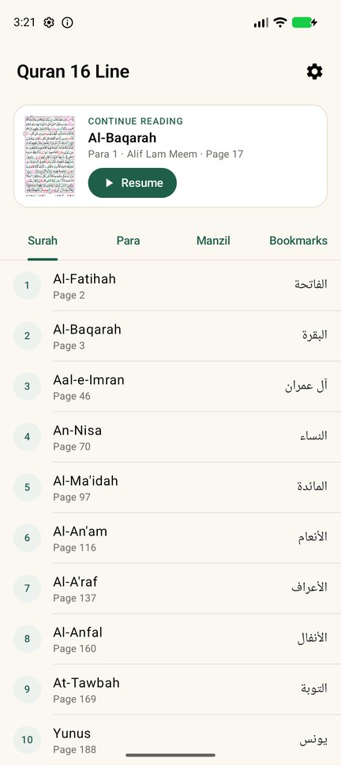
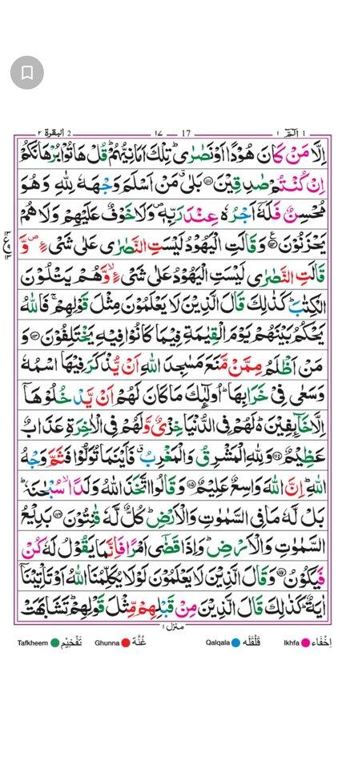
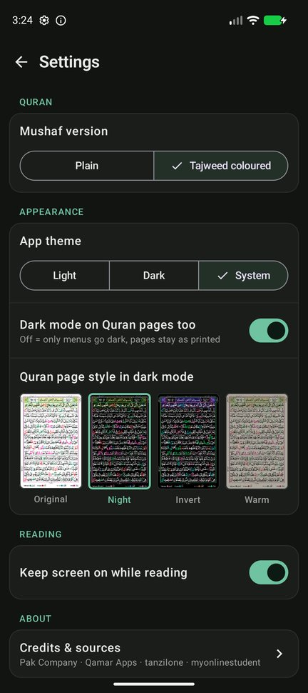

# Quran 16 Line

A simple, fast, offline Android app for reading the 16-line IndoPak Mushaf (548 pages), the print most people in Pakistan and India learn from.

Open the app, tap **Resume**, and keep reading from where you stopped.

<p>
  
  
  
  
</p>

## Features

- **Two editions:** Plain and Tajweed colour-coded. Both use the same page numbers, so switching keeps your place.
- **Resume:** the app remembers the last page you read.
- **Surah, Para (Juz) and Manzil** lists that jump straight to the right page.
- **Bookmarks:** tap the small button in the corner while reading. A default name (`Para – Surah – Pg`) is filled in, and you can type your own. Rename or delete them from Home.
- **Reading screen shows only the page:** full screen, swipe right for the next page (like a printed Mushaf), pinch or double-tap to zoom.
- **Pages are aligned:** every page is trimmed to its frame and sized identically, so nothing jumps while you swipe.
- **Light / Dark / System theme.** You choose whether dark mode also applies to the Quran pages, and in which style: Original, Night, Invert or Warm.
- **Extras:** Dua Khatm-ul-Quran, stop signs (Rumooz-e-Auqaf), and tajweed rules in Urdu, English, Persian, Pashto and Sindhi.
- Fully offline. No ads, no tracking, no internet permission. Android 7.0+.

## Install

Download `app-release.apk` from the [Releases](../../releases) page and open it on your phone (allow "install unknown apps" when asked). It's about 270 MB because both editions' pages are inside.

## Build it yourself

The page images aren't in this repo (too big for git). Rebuild them from the source PDFs:

1. Download the 30 Para PDFs of each edition into:
   - `source-pdfs/plain (tanzilone)/Para 01.pdf` … `Para 30.pdf` from <https://tanzilone.wordpress.com/>
   - `source-pdfs/tajweed coloured (myonlinestudent)/Para 01.pdf` … `Para 30.pdf` from <https://myonlinestudent.wordpress.com/read-quran/>
2. Convert and check the pages (Python 3, see [tools/README.md](tools/README.md)):
   ```bash
   pip install -r tools/requirements.txt
   python tools/convert_pages.py
   python tools/verify_pages.py
   ```
3. Build with Android Studio, or:
   ```bash
   ./gradlew :app:assembleRelease
   ```
   The APK is written to `app/build/outputs/apk/release/`.

Tests: `python -m pytest tools` and `./gradlew :app:testDebugUnitTest`.

## Credits and sources

- **Tajweed coloured edition:** "Quran 16 Line" by Qamar Apps (the PDF states CC BY-SA 4.0). The printed edition is credited to Pak Company (registered), March 2011, proofread by the Punjab Auqaf department. Downloaded from myonlinestudent.wordpress.com.
- **Plain edition:** downloaded from tanzilone.wordpress.com. The original publisher isn't stated.
- **Changes made:** pages were trimmed to their frame, aligned and resized for phone screens. The text is unchanged.

The original publishers of these scans couldn't be fully identified. If you hold rights to this material and want it removed, please [open an issue](../../issues) and it will be taken down.
