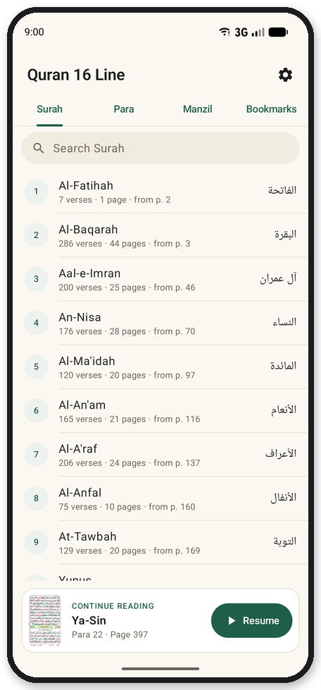
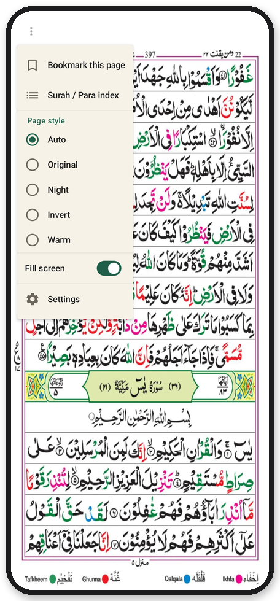
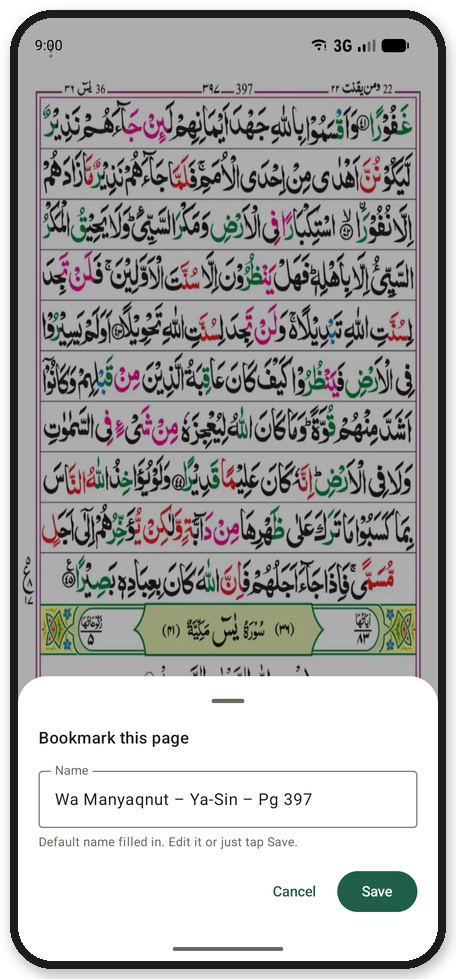
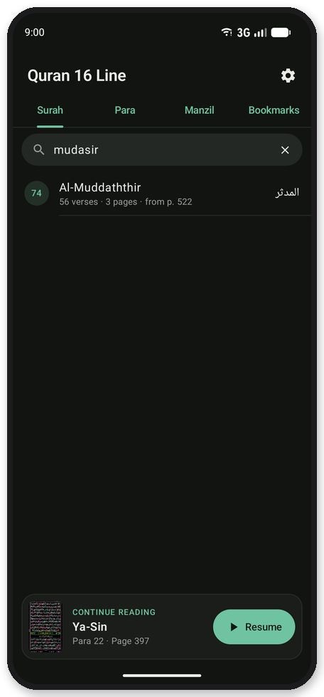
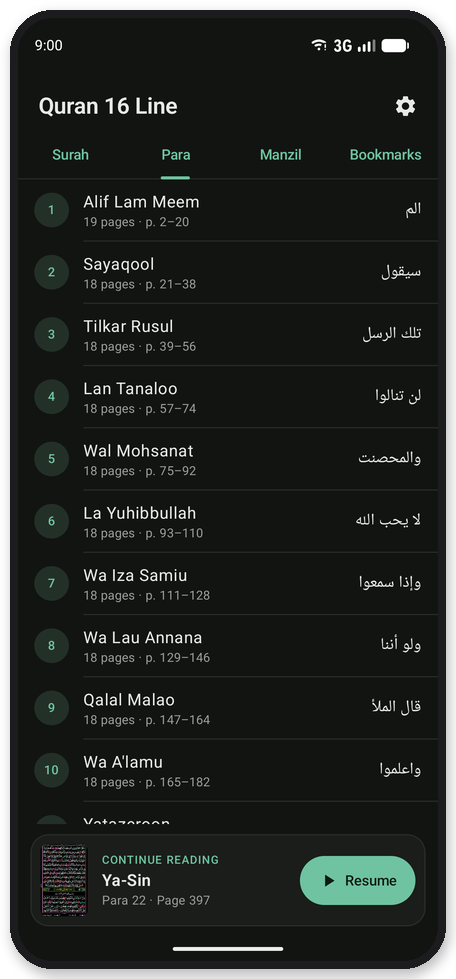
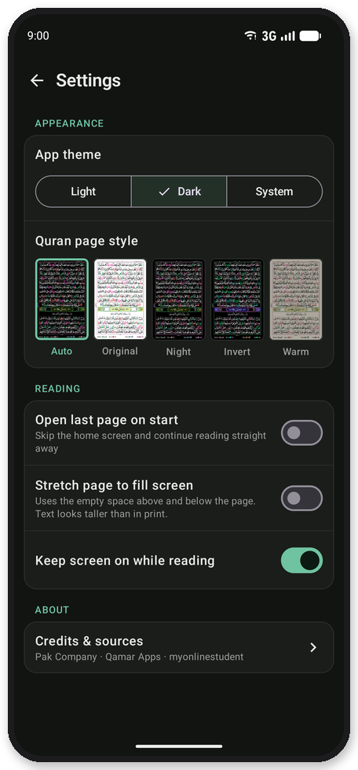

# Quran 16 Line: Free Offline Tajweed Quran App for Android (No Ads)

Read the **16-line IndoPak Quran** (*Hafizi Quran*, *Quran Majeed 16 lines*) with **colour-coded tajweed** on your Android phone. All 548 pages exactly as printed, the layout used for hifz in Pakistan, India and Bangladesh.

**Free · No ads · No tracking · Works offline**

قرآن مجید ١٦ سطری، تجوید کے رنگوں کے ساتھ، مفت، بغیر اشتہارات اور بغیر انٹرنیٹ کے۔

### [⬇ Download the latest APK](../../releases/latest)

<table>
  <tr>
    <td align="center" width="25%"><br><sub><b>Home and Resume</b></sub></td>
    <td align="center" width="25%"><br><sub><b>Printed 16-line page</b></sub></td>
    <td align="center" width="25%"><br><sub><b>One quiet ⋮ menu</b></sub></td>
    <td align="center" width="25%"><br><sub><b>Bookmarks</b></sub></td>
  </tr>
  <tr>
    <td align="center" width="25%"><br><sub><b>Search, typos welcome</b></sub></td>
    <td align="center" width="25%"><br><sub><b>Para, Surah, Manzil</b></sub></td>
    <td align="center" width="25%"><br><sub><b>Settings</b></sub></td>
    <td align="center" width="25%"><br><sub><b>Night reading</b></sub></td>
  </tr>
</table>

## Features

- **Resume** where you stopped, with one tap at the bottom of the screen, or open straight onto your last page.
- **Surah, Para (Juz) and Manzil** lists with verse and page counts. Page numbers match the printed copy.
- **Surah search** that forgives spelling: numbers, English or Arabic names, and spellings like Yaseen, Rehman, Kahaf or Mudassir.
- **Bookmarks** with a default name (`Para – Surah – Pg`) or your own.
- **Clean reading screen:** just the page and a faint ⋮ menu. Swipe right for the next page, like a printed Mushaf. Pinch or double-tap to zoom.
- **Aligned pages** that don't jump while you swipe, and an optional **Fill screen** mode that stays clear of notches and punch-hole cameras.
- **Light / Dark / System theme** plus page styles: Auto, Original, Night, Invert and Warm.
- **Extras:** Dua Khatm-ul-Quran, stop signs (Rumooz-e-Auqaf) and tajweed rules in Urdu, English, Persian, Pashto and Sindhi.

## Install

1. Download `Quran16Line-vX.Y.apk` from [Releases](../../releases) on your phone.
2. Open it and allow "install unknown apps" when asked. Android may warn about an unknown developer because the app isn't on the Play Store.

Needs Android 7.0 or newer (about 105 MB). Updates install over the old version and keep your bookmarks and last page.

## FAQ

**Is it free?** Yes. No ads, no in-app purchases, no tracking.

**Does it work offline?** Yes. All pages are inside the app, and it doesn't even ask for internet permission.

**Is it the 16-line Hafizi Quran?** Yes: the 16-line IndoPak Mushaf, 548 pages, Para 1 to 30, with tajweed colours for Tafkheem, Ghunna, Qalqala and Ikhfa.

**Is it on the Play Store?** Not yet. Install the APK from [Releases](../../releases).

## Found a mistake? Please let me know

This app was made with great care, but humans make mistakes. If you find a missing, repeated or misplaced page, a wrong Surah, Para, Manzil, verse count or page number, or any bug, please [report it](../../issues/new/choose) so it can be corrected as soon as possible.

If there is any mistake in this app, it is completely unintentional. No Muslim could ever think of making a mistake in the Quran on purpose. May Allah forgive our shortcomings and accept this humble effort. Ameen.

اگر اس ایپ میں کوئی غلطی ہے تو وہ ہرگز جان بوجھ کر نہیں کی گئی۔ کوئی مسلمان قرآنِ پاک میں جان بوجھ کر غلطی کرنے کا سوچ بھی نہیں سکتا۔ اگر آپ کو کوئی غلطی نظر آئے تو براہِ کرم ضرور بتائیں تاکہ اسے فوراً درست کیا جا سکے۔ اللہ تعالیٰ ہماری کوتاہیوں کو معاف فرمائے اور اس چھوٹی سی کوشش کو قبول فرمائے۔ آمین

## Credits and sources

"Quran 16 Line" by Qamar Apps (the PDF states CC BY-SA 4.0). The printed edition is credited to Pak Company (registered), March 2011, proofread by the Punjab Auqaf department. Downloaded from myonlinestudent.wordpress.com. Pages were only trimmed, aligned and resized for phone screens; the text is unchanged.

The original publisher of these scans couldn't be fully confirmed. If you hold rights to this material and want it removed, please [open an issue](../../issues) and it will be taken down.

<details>
<summary><b>Build it yourself</b></summary>

The page images aren't in this repo (too big for git), so rebuild them from the source PDFs:

1. Download the 30 Para PDFs from <https://myonlinestudent.wordpress.com/read-quran/> into `source-pdfs/tajweed coloured (myonlinestudent)/Para 01.pdf` … `Para 30.pdf`.
2. Convert and check the pages (Python 3, see [tools/README.md](tools/README.md)):
   ```bash
   pip install -r tools/requirements.txt
   python tools/convert_pages.py
   python tools/verify_pages.py
   ```
3. Build with Android Studio, or run `./gradlew :app:assembleRelease`. The release is signed with `release.keystore` if `keystore.properties` exists (both kept out of git); otherwise it uses the debug key.

Tests: `python -m pytest tools` and `./gradlew :app:testDebugUnitTest`.

</details>
